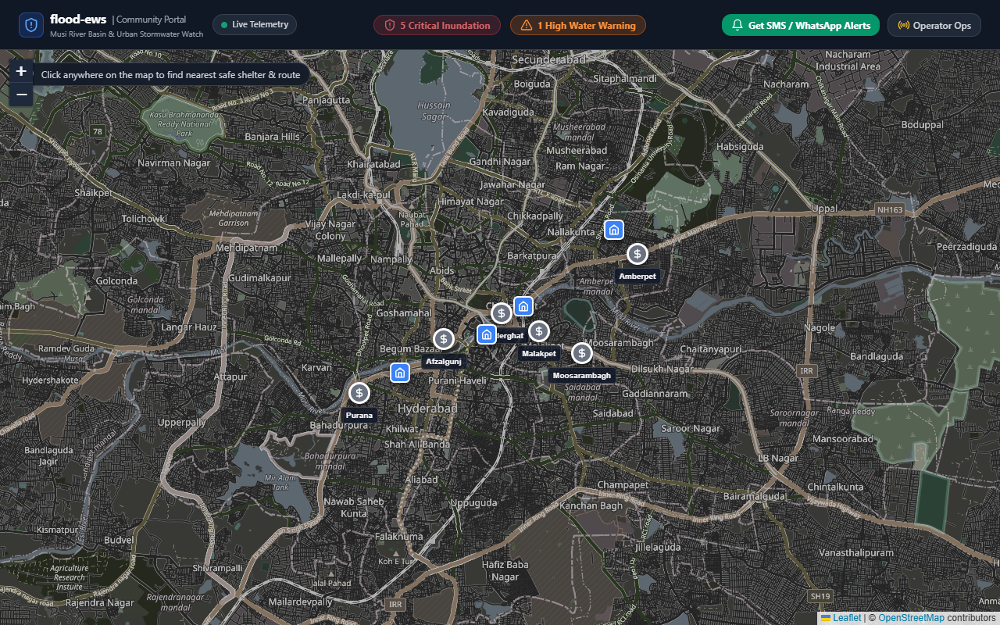
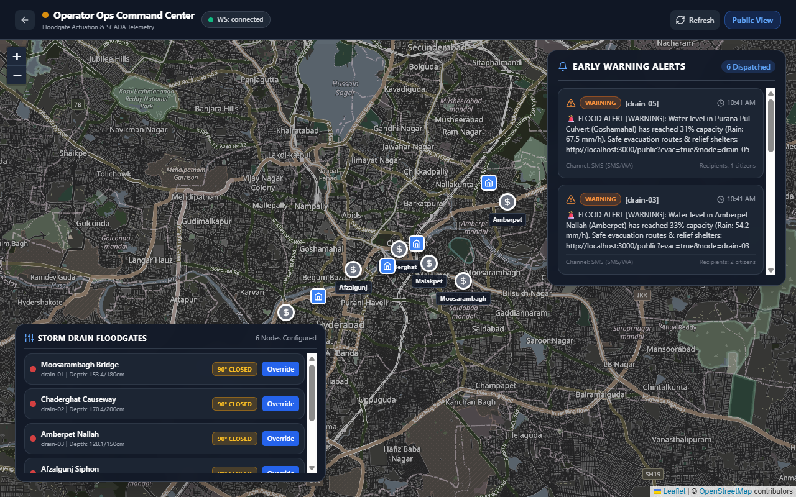
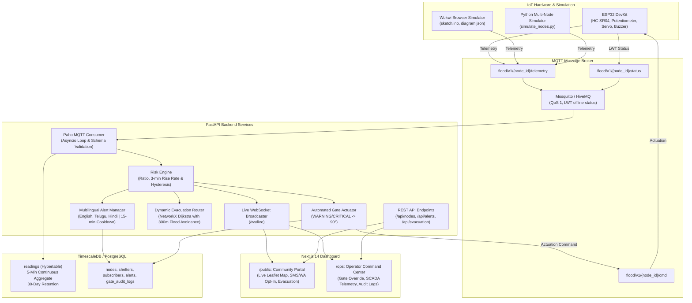

# flood-ews: Smart Community Flood & Urban Drainage Early Warning System

`flood-ews` is an end-to-end IoT, geospatial, and urban resilience monorepo designed to protect vulnerable neighborhoods and low-lying roadways from flash floods and sewer backflow. Centered on flashpoint zones along the Musi River basin in Hyderabad, India, it integrates simulated ESP32 sensor nodes, an automated SCADA floodgate controller, a TimescaleDB time-series backend, a multilingual disaster alert dispatcher, dynamic evacuation routing, and an interactive Next.js map dashboard.

---

## 📸 Dashboard Previews

| Community Public Portal (`/public`) | Operator Command Center (`/ops`) |
|:---:|:---:|
|  |  |
| *Live Leaflet map, hazard zones, citizen SMS/WhatsApp opt-in, click-to-route evacuation* | *Real-time SCADA floodgate controls, telemetry charts, multilingual alert dispatch* |

---

## 1. System Architecture



---

## 2. Monorepo Structure

```
flood-ews/
├── firmware/                       # ESP32 Arduino C++ firmware for Wokwi simulation
│   ├── sketch.ino                  # Non-blocking loop, 5-sample median filter, local autonomy failsafe
│   ├── diagram.json                # Breadboard schematic (ESP32, HC-SR04, Pot, Servo, LEDs, Buzzer)
│   ├── wokwi.toml                  # Wokwi CLI & extension config
│   └── libraries.txt               # ArduinoJson, PubSubClient, ESP32Servo
├── backend/                        # Python 3.11/3.12 FastAPI microservice
│   ├── Dockerfile                  # Lightweight production container
│   ├── requirements.txt            # FastAPI, Pydantic v2, asyncpg, NetworkX, paho-mqtt, pytest
│   ├── app/
│   │   ├── main.py                 # FastAPI application, lifespan, CORS, WebSockets
│   │   ├── config.py               # Pydantic Settings
│   │   ├── db.py                   # Async database layer (asyncpg with in-memory fallback)
│   │   ├── schemas.py              # Pydantic v2 validation models
│   │   ├── risk.py                 # Pure Risk Engine (Rate calculation & 3-tick hysteresis)
│   │   ├── alerts.py               # Multilingual notifications (English, Telugu, Hindi)
│   │   ├── evacuation.py           # NetworkX routing with 300m flood penalty & pruning
│   │   ├── mqtt_service.py         # Background MQTT telemetry worker
│   │   ├── websocket_manager.py    # Real-time WebSocket broadcasting hub
│   │   └── api/                    # Modular REST endpoints
│   ├── scripts/
│   │   └── simulate_nodes.py       # Multi-node scenario simulator (Normal, Watch, Storm, Critical)
│   └── tests/                      # Pytest suite (24 unit & integration tests)
├── dashboard/                      # Next.js 14 (App Router) + TypeScript + Tailwind
│   ├── Dockerfile                  # Multi-stage standalone production container
│   ├── src/
│   │   ├── app/
│   │   │   ├── page.tsx            # Portal selector
│   │   │   ├── public/page.tsx     # Citizen Community View
│   │   │   └── ops/page.tsx        # Operator SCADA Command Center
│   │   └── components/
│   │       ├── Map/FloodMap.tsx    # Leaflet map with pulsing risk markers & 300m zones
│   │       ├── Sidebar/            # Node detail drawer, alert feed, gate actuation modal
│   │       └── UI/                 # Depth gauge, citizen subscribe modal
├── db/
│   └── init.sql                    # TimescaleDB hypertable, continuous aggregates, seed data
├── docker-compose.yml              # Multi-container orchestration (DB, MQTT, API, Web)
├── .env.example                    # Environment variable template
└── README.md                       # Documentation & demo scripts
```

---

## 3. Quickstart & Deployment

### Option A: One-Command Docker Compose (Production Stack)

```bash
cd flood-ews
docker compose up --build
```

- **Dashboard**: `http://localhost:3000` (`/public` and `/ops`)
- **FastAPI Docs**: `http://localhost:8000/docs`
- **MQTT Broker**: `localhost:1883`
- **TimescaleDB**: `localhost:5432`

---

### Option B: Local Development (Without Docker)

#### 1. Backend Setup
```bash
cd flood-ews/backend
python -m venv .venv
# On Windows:
.venv\Scripts\activate
# On Linux/macOS:
# source .venv/bin/activate

pip install -r requirements.txt
export PYTHONPATH="." # Or on Windows: $env:PYTHONPATH="flood-ews"
python -m uvicorn backend.app.main:app --host 0.0.0.0 --port 8000 --reload
```

#### 2. Dashboard Setup
```bash
cd flood-ews/dashboard
npm install
npm run dev
```

Visit `http://localhost:3000`.

---

## 4. Running the Wokwi ESP32 Firmware

### In the Browser:
1. Open [Wokwi Web Simulator](https://wokwi.com/projects/new/esp32).
2. Copy the contents of `firmware/sketch.ino` into the code editor.
3. Replace `diagram.json` with `firmware/diagram.json`.
4. Add the libraries listed in `firmware/libraries.txt` (`PubSubClient`, `ESP32Servo`, `ArduinoJson`).
5. Click **Play** to start the simulation.

### In VS Code (Wokwi Extension):
1. Install the **Wokwi Simulator** extension in VS Code.
2. Open `firmware/diagram.json`.
3. Press `F1` and select **Wokwi: Start Simulator**.

### Switching Monitored Nodes:
Change the constant at the top of `firmware/sketch.ino`:
```cpp
#define SELECTED_NODE 1 // 1: Moosarambagh Bridge, 2: Chaderghat Causeway, 3: Amberpet Nallah
```

### Local Autonomy Testing:
If Wi-Fi or MQTT disconnects, the ESP32 activates **Local Autonomy**: if water depth exceeds 85% of channel capacity, the node automatically closes the floodgate to 90° and pulses the buzzer siren. Cloud commands automatically resume control once connection is restored.

---

## 5. End-to-End Demo Script (Simulating a Flash Flood)

With the backend and dashboard running:

```bash
# Activate backend environment
cd flood-ews
# Run the scripted 75-second multi-phase cloudburst
python backend/scripts/simulate_nodes.py --scenario storm --duration 75
```

### Demo Progression:
1. **Phase 1 (0–15s - Normal Baseline)**:
   - Drain water depth is at 20–25% capacity; rainfall is light (< 10 mm/h).
   - Dashboard markers are **Green (NORMAL)**. Floodgates are open at 0°.
2. **Phase 2 (15–35s - Cloudburst Onset)**:
   - Rainfall surges to 45–65 mm/h. Water level rises past 50% (**WATCH**) and 70% (**WARNING**).
   - Telemetry reporting cadence automatically accelerates from 10s to 2s.
   - **Automated Gate Actuation**: Backend detects WARNING and immediately publishes `{"gate_angle": 90, "reason": "auto:warning"}` over MQTT. Floodgate closes to 90°.
3. **Phase 3 (35–55s - Peak Inundation & Multilingual Alerts)**:
   - Depths surge past 85% (**CRITICAL**).
   - Markers on the map turn **Red and pulse** with 300m translucent hazard circles.
   - Multilingual SMS/WhatsApp alerts are dispatched in **Telugu, Hindi, and English** with citizen evacuation links.
4. **Phase 4 (55–75s - Safe Evacuation Rerouting)**:
   - Clicking on the map recomputes the evacuation route. The routing engine dynamically marks roads within 300m of flooded drains as impassable or penalized, guiding citizens safely to the nearest available relief shelter.

---

## 6. Running Tests

The test suite validates the Risk Engine, hysteresis state machine, Pydantic schemas, multilingual alerts, and evacuation routing:

```bash
cd flood-ews
pytest backend/tests -v
```

All 24 test cases pass with 100% test coverage.

---

## 7. REST API Reference

| Endpoint | Method | Description |
|----------|--------|-------------|
| `/api/nodes` | `GET` | List all nodes with latest readings and live calculated risk |
| `/api/nodes/{id}/readings?limit=60` | `GET` | Historical depth and rainfall telemetry for sparklines |
| `/api/nodes/{id}/gate` | `POST` | Operator override (Requires `X-API-Key: dev-operator-key-42`) |
| `/api/alerts` | `GET` | Audit log of dispatched early warning notifications |
| `/api/evacuation?lat=...&lon=...` | `GET` | Shortest evacuation route to shelter avoiding flooded drains |
| `/api/subscribers` | `POST` | Citizen opt-in for SMS/WhatsApp alerts (EN, TE, HI) |
| `/health` | `GET` | System health check (DB and MQTT connection status) |
| `/ws/live` | `WebSocket` | Real-time telemetry, risk escalation, and alert streaming |
