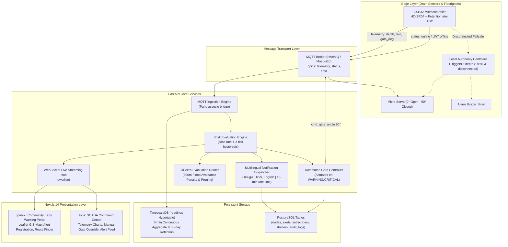

# System Architecture: flood-ews

`flood-ews` is designed with an asynchronous, edge-to-cloud urban early warning architecture. It provides high resilience against extreme weather events through localized failsafes, hysteresis-based predictive risk classification, and dynamic routing that avoids inundated roadways.

---

## 1. End-to-End Data Flow

---

## 2. Key Architecture Components

### A. Edge Layer & Local Autonomy
- **5-Sample Median Filter**: Discards acoustic echoes and transient water surface ripples in storm channels.
- **Adaptive Cadence**: 10-second normal cadence accelerates to 2 seconds when water depth exceeds 70% of channel capacity.
- **Failover Autonomy**: When network infrastructure collapses during an extreme cloudburst, the ESP32 node enters autonomous mode: if water exceeds 85% capacity, it directly actuates the gate to 90° and pulses the siren buzzer. Cloud commands seamlessly resume priority once network connectivity is re-established.

### B. Risk Classification & Hysteresis Engine
- **Rise Rate Computation**: $\text{rate} = \frac{\text{depth}_{\text{now}} - \text{depth}_{3\text{min}}}{\Delta t}$ in cm/min.
- **Risk Thresholds**:
  - `NORMAL`: fill ratio $< 50\%$ and rate $\le 5$ cm/min.
  - `WATCH`: $50\% \le \text{ratio} < 70\%$ OR rate $> 5$ cm/min.
  - `WARNING`: $70\% \le \text{ratio} < 85\%$ OR ($\text{rain} > 30$ mm/h and rising).
  - `CRITICAL`: fill ratio $\ge 85\%$.
- **Asymmetric Hysteresis**: Escalates instantaneously upon reaching an elevated threshold; requires 3 consecutive lower readings before de-escalating to prevent actuator chattering caused by storm waves.

### C. Dynamic Evacuation Graph Routing
- Utilizes NetworkX to model urban road networks.
- Applies a **100x travel time penalty** to all road segments within 300 meters of any node at `WARNING`.
- Completely **prunes/removes** road segments within 300 meters of any node at `CRITICAL`.
- Computes Dijkstra shortest path to the nearest relief shelter that currently has available bed capacity.

### D. Multilingual Alerting Engine
- Enforces a 15-minute cooldown per node on level escalation.
- Dynamically formats localized text alerts in **Telugu**, **Hindi**, and **English**.
- Injects citizen evacuation links directly into warning and critical alerts.
