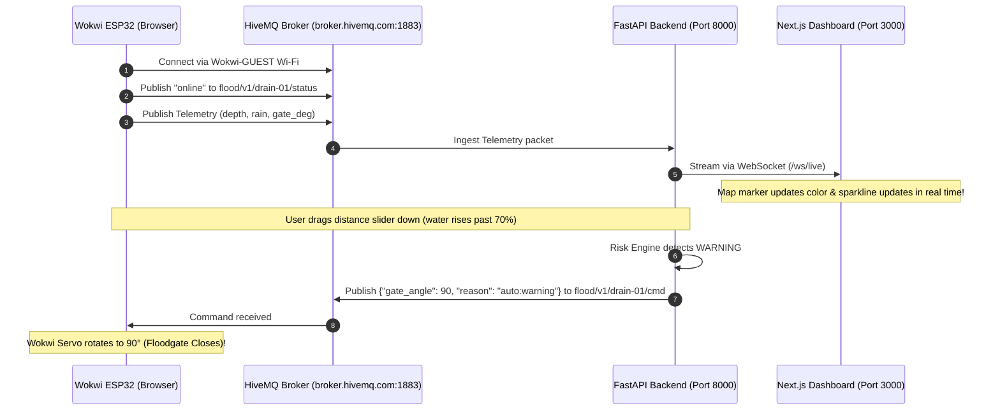

# Wokwi ESP32 Virtual Simulation Guide: flood-ews

`flood-ews` is designed to run **100% in simulation** using [Wokwi](https://wokwi.com) with no physical microcontroller hardware required. The simulated ESP32 node communicates live with the backend and Next.js dashboard over the public HiveMQ MQTT broker (`broker.hivemq.com:1883`).

---

## 1. Virtual Hardware Components in Wokwi

```
        +-----------------------------------------------------------+
        |                 WOKWI ESP32 VIRTUAL BREADBOARD            |
        |                                                           |
        |   [HC-SR04 Ultrasonic]       [Potentiometer Rain Gauge]   |
        |    Trig: GPIO 5               Signal: GPIO 34 (ADC1_CH6)  |
        |    Echo: GPIO 18                                          |
        |                                                           |
        |   [Micro Servo Floodgate]    [Status LEDs & Buzzer]       |
        |    PWM: GPIO 19               Green LED: GPIO 22 (Online) |
        |                               Red LED:   GPIO 21 (Alert)  |
        |                               Buzzer:    GPIO 23 (Siren)  |
        +-----------------------------------------------------------+
```

| Component | Wokwi Part Type | Function | Pin Connection |
|---|---|---|---|
| **ESP32 DevKit** | `wokwi-esp32-devkit-v1` | Core SoC Microcontroller | Power, GND & GPIOs |
| **Ultrasonic Sensor** | `wokwi-hc-sr04` | Measures channel water depth | Trig -> `GPIO 5`, Echo -> `GPIO 18` |
| **Potentiometer** | `wokwi-potentiometer` | Simulates precipitation (0–100 mm/h) | Wiper -> `GPIO 34` (ADC) |
| **Micro Servo** | `wokwi-servo` | Actuates floodgate (0° Open – 90° Closed) | PWM -> `GPIO 19` |
| **Green LED** | `wokwi-led` (green) | Visual indicator for MQTT connectivity | Anode -> `GPIO 22` via 220Ω |
| **Red LED** | `wokwi-led` (red) | Visual indicator for Warning/Critical flood | Anode -> `GPIO 21` via 220Ω |
| **Piezo Buzzer** | `wokwi-buzzer` | Local emergency acoustic siren | Pin 1 -> `GPIO 23` |

---

## 2. Running in the Wokwi Browser (Step-by-Step)

1. Open [https://wokwi.com/projects/new/esp32](https://wokwi.com/projects/new/esp32) in your browser.
2. In the code tab (`sketch.ino`), replace all code with the contents of:  
   👉 [`firmware/sketch.ino`](../firmware/sketch.ino)
3. In the diagram tab (`diagram.json`), replace all code with the contents of:  
   👉 [`firmware/diagram.json`](../firmware/diagram.json)
4. In the **Libraries** tab (or `libraries.txt`), add these three libraries:
   - `PubSubClient`
   - `ArduinoJson`
   - `ESP32Servo`
5. Click the green **Play (Start Simulation)** button.

---

## 3. How Wokwi Communicates Live with Your Dashboard



---

## 4. Testing Interactive Scenarios in Wokwi

### Scenario A: Normal Operating Conditions
- In Wokwi, leave the ultrasonic distance target around **150 cm** (low water level).
- Observe the Serial Monitor:
  ```
  [TELEMETRY] flood/v1/drain-01/telemetry -> {"node":"drain-01","depth_cm":50.0,"rain_mm_h":10.0,"gate_deg":0}
  ```
- The Green LED is ON (Connected). Red LED is OFF. Gate is at 0° (Open). Telemetry is sent every **10 seconds**.

### Scenario B: Cloudburst & Automated Gate Closure
- Click on the **HC-SR04** sensor in Wokwi and drag the distance target to **30 cm** (simulating deep water / 150 cm depth in a 180 cm capacity drain).
- Observe:
  1. The reporting cadence **automatically accelerates from 10s to 2s**.
  2. The Red LED turns solid ON (**WARNING**).
  3. The backend receives the elevated depth, detects `WARNING` level, and publishes the gate command over HiveMQ.
  4. In the Wokwi canvas, the **Servo rotates to 90° (Closed)** to prevent street sewer backflow!

### Scenario C: Local Autonomy Failsafe (Offline Storm)
- In `sketch.ino` in Wokwi, change `WIFI_SSID` to `"Offline-Test"` (to simulate total storm communication failure).
- Restart simulation and drag water depth above 85% capacity (distance < 27 cm).
- Observe:
  - Wi-Fi/MQTT is disconnected (Green LED OFF).
  - The node's **Local Autonomy** algorithm triggers independently:
    - Sets gate angle to **90° (Closed)** without waiting for cloud command.
    - Sounds the **Buzzer** siren continuously.

---

## 5. Simulating Multiple Nodes in Wokwi

To simulate different flashpoints in Tirupati in Wokwi, simply change the `#define SELECTED_NODE` constant at line 35 in `sketch.ino`:

```cpp
#define SELECTED_NODE 1  // Node 1: Kapilatheertham Nallah (180cm capacity)
// #define SELECTED_NODE 2  // Node 2: Leela Mahal Culvert (200cm capacity)
// #define SELECTED_NODE 3  // Node 3: Railway Underbridge (West) (150cm capacity)
```

Each preset automatically configures the appropriate node ID, channel mount height, and street flood overflow capacity.
